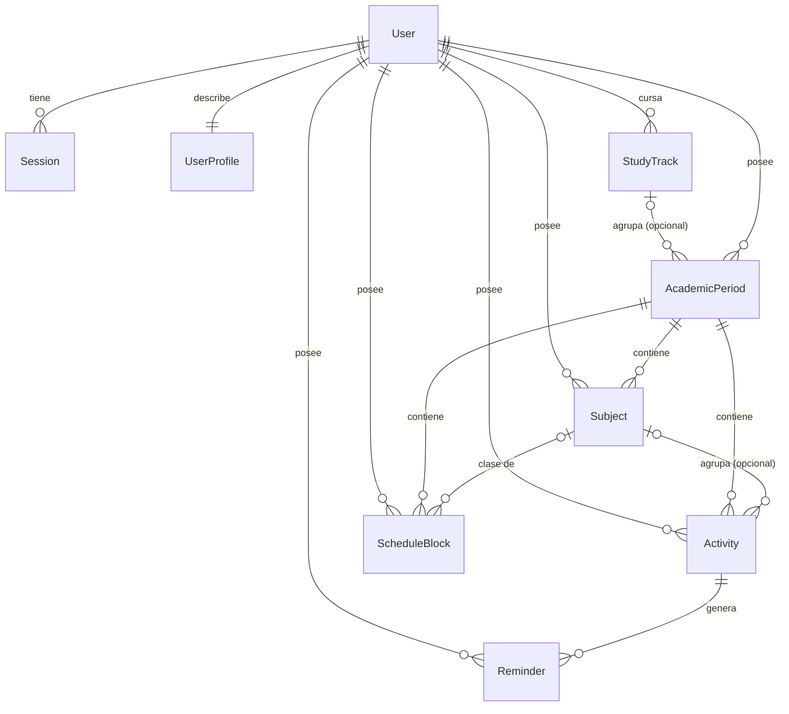

# Modelo de datos

Fuente de verdad: [`apps/api/prisma/schema.prisma`](../apps/api/prisma/schema.prisma) y las migraciones de `apps/api/prisma/migrations/`. Este documento explica las entidades y reglas; no copia el esquema línea por línea. PostgreSQL 17, gestionado con Prisma 7.

## Diagrama simplificado

## Relaciones

| Relación                                                                      | Cardinalidad | Borrado                                                                                                       |
| ----------------------------------------------------------------------------- | ------------ | ------------------------------------------------------------------------------------------------------------- |
| `User` → `Session`                                                            | 1:N          | En cascada con el usuario                                                                                     |
| `User` → `AcademicPeriod`, `Subject`, `Activity`, `ScheduleBlock`, `Reminder` | 1:N          | En cascada con el usuario (borrar un usuario elimina todo lo suyo)                                            |
| `AcademicPeriod` → `Subject`                                                  | 1:N          | **No en cascada** (`NO ACTION`): un periodo con asignaturas no se puede borrar (409)                          |
| `AcademicPeriod` → `ScheduleBlock`                                            | 1:N          | **No en cascada**: un periodo con bloques no se puede borrar                                                  |
| `AcademicPeriod` → `Activity`                                                 | 1:N          | **No en cascada**: un periodo con actividades (también generales) no se puede borrar (409)                    |
| `Subject` → `Activity`                                                        | 1:N opcional | **No en cascada**: una asignatura con actividades o bloques no se puede borrar (409); `subjectId` es opcional |
| `Subject` → `ScheduleBlock`                                                   | 1:N opcional | **No en cascada**; `subjectId` es opcional (una sesión de estudio puede no tener asignatura)                  |
| `Activity` → `Reminder`                                                       | 1:N          | **En cascada**: borrar una actividad borra sus recordatorios                                                  |

Una `Activity` **guarda su periodo** (`periodId`, obligatorio, inmutable) y su asignatura es **opcional** (F1). Si hay asignatura, la clave foránea compuesta `(subjectId, periodId) → Subject(id, periodId)` hace que la **propia base de datos** rechace una asignatura de otro periodo. Detalle y decisiones: [activities.md](activities.md#el-periodo-sí-se-guarda-en-activity-la-asignatura-es-opcional-f1).

## Entidades

### User

`name`, `email` (único, siempre recortado y en minúsculas), `passwordHash` (Argon2id), `timezone` (por defecto `America/Bogota`). La zona horaria es la **autoridad** para «hoy», el saludo, la semana y el día en que vence una actividad sin hora. No hay pantalla para cambiarla (ver [limitations.md](limitations.md)).

### UserProfile

El perfil educativo, **1:1 con `User`** (`userId` es la clave primaria y la FK, `ON DELETE CASCADE`): `primaryUse` (nullable: `UNIVERSITY_STUDENT`, `SCHOOL_STUDENT`, `OTHER_STUDENT`, `TEACHER`, `PERSONAL`; qué dice la persona que hace con la app, **no un rol de autorización**), `programName` (nullable, 1–80 caracteres, **la autoridad**: lo que la persona escribió o el nombre canónico del catálogo), `programKey` (nullable; referencia opcional al catálogo pequeño de `@planner/core`, nunca gobierna reglas y exige `programName`) y `onboardingStatus` (`NOT_STARTED` por omisión, `IN_PROGRESS`, `COMPLETED`, `SKIPPED`: es solo un dato, ningún estado bloquea iniciar sesión ni usar la app). Toda cuenta tiene exactamente una fila: la crea el registro en la misma sentencia que el usuario (una transacción) y la migración la creó para los usuarios que ya existían; **ninguna petición la crea ni la repara** (si faltara, `500 PROFILE_INVARIANT_BROKEN`). `User` sigue siendo solo identidad y autenticación. Detalle: [decisión D26](decisions.md#d26-perfil-educativo-separado-del-usuario).

### StudyTrack

Una **formación que el usuario cursa** (P0.5-1, [D31](decisions.md#d31-studytrack-una-formación-que-el-usuario-cursa-p05-1)): `userId` (FK, `ON DELETE CASCADE`), `name` (el nombre visible: obligatorio, recortado, 1–80, no necesariamente una carrera), `type` (`EducationContext`: `UNIVERSITY` | `SCHOOL` | `OTHER_ACADEMIC`, **editable**; descriptivo, no una autorización; cambiarlo no toca `Subject.educationContext`), `programKey` (nullable, del catálogo; con clave el nombre es el canónico), `isPrimary`, `status` (`ACTIVE` | `ARCHIVED`; un estudio se archiva, no se borra). Un usuario tiene **0..n**; **a lo sumo un principal**, hecho cumplir por la BD (índice único parcial `(userId) WHERE isPrimary` y `CHECK (isPrimary → ACTIVE)`; hay `CHECK` de nombre recortado de 1–80 y de clave de 1–60). `@@unique([id, userId])` es el destino de la futura clave foránea compuesta de un periodo. Un **periodo** puede pertenecer a uno (`AcademicPeriod.studyTrackId`, [D32](decisions.md#d32-un-periodo-puede-pertenecer-a-un-estudio-p05-2)); `Subject`, `Activity` y `ScheduleBlock` llegan al estudio **por su periodo** (no tienen `studyTrackId`) y `UserProfile` no está enlazado. Las migraciones **no crean ninguno** (todas las cuentas tienen cero hasta que alguien lo cree).

**Cómo nace un estudio (P0.5-4, P0.5-5).** Solo por una petición explícita: `POST /api/study-tracks` (solo el estudio), `POST /api/study-tracks/setup` (estudio + primer periodo + materias, atómico), `POST /api/study-tracks/adopt-period` (estudio + un periodo existente sin estudio, atómico y sin copiar nada) o `POST /api/onboarding/complete` (el estudio principal de quien termina el onboarding estudiando, adoptando su periodo; idempotente y sin pisar un estudio ya montado). Nada lo crea desde el registro, un inicio de sesión, una lectura, el perfil ni el nombre de un periodo. **Autoridad:** con algún estudio, el estudio manda sobre `UserProfile.programName/programKey`, que quedan como metadatos heredados (no se borran, no se sincronizan) y no se pueden editar por `PATCH /api/profile` ([D34](decisions.md#d34-mis-estudios-y-adopción-explícita-p05-4)).

### Session

Sesión en servidor. Guarda `tokenHash` (SHA-256 del token aleatorio de 256 bits; el token en claro **nunca** se almacena), `expiresAt` (7 días fijos desde su creación), `lastUsedAt`. Máximo 20 sesiones vivas por usuario (se descartan las más antiguas). Detalle en [security.md](security.md).

### AcademicPeriod

`name`, `startDate`, `endDate` (**fechas de calendario** `DATE`, sin hora ni zona: «2026-08-03» no puede correrse al día 2 por una conversión), `isCurrent` (actual **dentro de su ámbito**: «sin estudio» o un estudio), `studyTrackId` (nullable: el estudio al que pertenece, [D32](decisions.md#d32-un-periodo-puede-pertenecer-a-un-estudio-p05-2); `NULL` es un estado permanente y válido, no hay estudio «Personal») y el **nivel de estudio durante el periodo**: `studyLevel` (entero nullable, 1–99) **o** `studyLevelNote` (texto corto nullable, 1–40 caracteres, para «Otro» o una estructura que un número no describe), nunca los dos. Vive en el periodo y no en el perfil porque cambia con cada periodo («2026-2, semestre 4» y luego «2027-1, semestre 5»); es genérico a propósito (el dominio no sabe si es semestre, grado o año de un curso, ni si el estudiante es universitario). Restricciones a mano en la migración: **un solo periodo actual sin estudio por usuario y uno por estudio** (dos índices únicos parciales; un periodo general y los de varios estudios pueden ser actuales a la vez), la clave foránea compuesta `(studyTrackId, userId)` hacia `StudyTrack` (un periodo nunca apunta al estudio de otro usuario; `NO ACTION`), `endDate > startDate` y los tres `CHECK` del nivel (rango 1–99, nota de 1 a 40 caracteres, a lo sumo uno de los dos). Los periodos que ya existían quedan con ambos campos en `NULL`. Decisión [D27](decisions.md#d27-el-nivel-de-estudio-vive-en-el-periodo-académico).

### Subject

`name` (como lo escribió el usuario), `nameKey` (normalizado: minúsculas, sin acentos, espacios colapsados), `professor?`, `color` (uno de los 10 hex de la paleta fija, validado en `core`), `description?`, `educationContext?` (`UNIVERSITY`, `SCHOOL` u `OTHER_ACADEMIC`: de qué tipo de estudio viene la asignatura; **no existe `PERSONAL`**, lo personal son actividades sin asignatura). `NULL` significa «no especificado» y **no** equivale a ninguno de los tres: las asignaturas que ya existían quedaron en `NULL` y nada las infiere. **No** dice si la asignatura se califica (eso será una configuración propia de B1/B2: `UNIVERSITY` no implica notas). Único `(periodId, nameKey)`: no se repiten asignaturas «iguales» dentro de un periodo. Decisión [D28](decisions.md#d28-el-contexto-educativo-de-una-asignatura).

### Activity

| Campo         | Significado                                                                                                                                                                                                                                                        |
| ------------- | ------------------------------------------------------------------------------------------------------------------------------------------------------------------------------------------------------------------------------------------------------------------ |
| `periodId`    | Periodo al que pertenece. **Obligatorio e inmutable**; lo deriva el servidor (el de la asignatura, o el periodo hogar si no hay asignatura). Se expone solo para **leer** (`periodId` en el DTO, desde P0.5-3: así se halla su estudio); ninguna petición lo envía |
| `subjectId`   | Asignatura **opcional**. Nulo = actividad general (sin asignatura). Con valor, su periodo es el mismo `periodId` (clave foránea compuesta)                                                                                                                         |
| `type`        | `TASK`, `EXAM`, `QUIZ`, `PROJECT`, `PRESENTATION`, `WORKSHOP`, `READING`, `OTHER` (por defecto `TASK`)                                                                                                                                                             |
| `priority`    | `LOW`, `MEDIUM`, `HIGH` (por defecto `MEDIUM`)                                                                                                                                                                                                                     |
| `status`      | `PENDING`, `IN_PROGRESS`, `COMPLETED` (por defecto `PENDING`)                                                                                                                                                                                                      |
| `dueAt`       | **Instante UTC**. Con `hasTime = false` es el **final del día local** del usuario (23:59:59.999)                                                                                                                                                                   |
| `hasTime`     | Si el estudiante indicó hora. Sin hora no se inventa «11:59 p. m.» en pantalla                                                                                                                                                                                     |
| `completedAt` | Lo fija el **backend**, nunca el cliente: pasar a `COMPLETED` estampa «ahora», seguir finalizada conserva la marca, reabrir la borra. Restricción: `status = COMPLETED` ⇔ `completedAt` no nulo                                                                    |

Límites de texto: título 150 caracteres, descripción 2000.

### ScheduleBlock

Una fila por bloque **o por serie semanal**; las ocurrencias se expanden al leer, solo para el rango pedido.

| Campo                    | Significado                                                                                                                           |
| ------------------------ | ------------------------------------------------------------------------------------------------------------------------------------- |
| `type`                   | `CLASS`, `STUDY`, `ACADEMIC_PERSONAL` (una clase exige asignatura)                                                                    |
| `periodId`, `subjectId?` | Periodo (siempre) y asignatura (opcional salvo en clases); la asignatura debe ser del mismo periodo                                   |
| `startAt`, `endAt`       | Instantes UTC de la **primera** (o única) ocurrencia. Restricción: `endAt > startAt` y duración ≤ 24 h                                |
| `recurrenceType`         | `NONE` o `WEEKLY`                                                                                                                     |
| `recurrenceUntil`        | Fecha local inclusiva en que termina la serie (no puede pasar del fin del periodo). Restricción: `WEEKLY` ⇔ `recurrenceUntil` no nulo |

El día de la semana no se guarda: es el de la primera ocurrencia en la zona del usuario. Una serie repite la **misma hora de pared** cada 7 días **de calendario** (no cada 168 horas), así que conserva su hora aunque cambie el desfase horario.

### Reminder

Recordatorio **interno** (dentro de la app). Solo guarda el _cuándo_; el mensaje se deriva de la actividad al mostrarlo (renombrar la actividad renombra sus recordatorios).

| Campo           | Significado                                                                                                                          |
| --------------- | ------------------------------------------------------------------------------------------------------------------------------------ |
| `kind`          | `AUTO` (generado por las reglas del tipo de actividad) o `MANUAL` (lo eligió el estudiante; nunca se recalcula)                      |
| `status`        | `PENDING` (aún no mostrado) → `SHOWN` (la app lo mostró) o `CANCELLED` (la actividad se finalizó)                                    |
| `offsetMinutes` | Solo `AUTO`: minutos **negativos** respecto a `dueAt` (`remindAt = dueAt + offset`). Restricción: `AUTO` ⇔ offset no nulo y negativo |
| `remindAt`      | Instante UTC en que debe mostrarse                                                                                                   |

Índice único parcial: una actividad no puede tener dos `AUTO` con el mismo offset. Reglas por tipo y ciclo de vida: [reminders.md](reminders.md).

## Datos derivados (no se almacenan)

Se calculan en cada lectura con un reloj inyectable; guardarlos obligaría a mantenerlos al día y permitiría que se contradijeran.

| Dato                        | Se deriva de                                                                  | Dónde                                                |
| --------------------------- | ----------------------------------------------------------------------------- | ---------------------------------------------------- |
| Vencida                     | `dueAt < ahora` y `status ≠ COMPLETED`                                        | [activities.md](activities.md)                       |
| Categoría del Radar         | Tiempo restante hasta `dueAt` (duración real)                                 | [radar.md](radar.md)                                 |
| Puntaje y orden de Atención | Radar + prioridad + estado + plazo (el puntaje nunca se muestra ni se guarda) | [attention-engine.md](attention-engine.md)           |
| Progreso                    | Actividades finalizadas / registradas                                         | [progress-and-workload.md](progress-and-workload.md) |
| Carga semanal               | Actividades que vencen en la semana + ocurrencias de la agenda                | [progress-and-workload.md](progress-and-workload.md) |
| Mensaje de un recordatorio  | Título y plazo actuales de la actividad                                       | [reminders.md](reminders.md)                         |
| Ocurrencias de una clase    | La fila de la serie y el rango consultado                                     | [schedule.md](schedule.md)                           |

## Convenciones de tiempo

- Instantes: `timestamptz` (UTC). La API los intercambia en ISO 8601 con `Z`; la interfaz los localiza con `User.timezone`.
- Días de calendario (periodos, `recurrenceUntil`): `DATE`, intercambiados como `YYYY-MM-DD`.
- Semana: **lunes a domingo**, en la zona del usuario.
- Actividad sin hora: vence al **final del día local**.

## Migraciones

Diez migraciones aplicadas en orden (`init`, `auth_user_session_drop_app_metadata`, `academic_periods_and_subjects`, `activities`, `schedule_blocks`, `reminders`, `activity_period_optional_subject`, `user_profile`, `period_study_level`, `subject_education_context`). Las invariantes que Prisma no sabe expresar (índices únicos parciales, `CHECK`) están escritas a mano al final de cada migración. **Nunca se edita una migración ya aplicada**: se crea otra.
