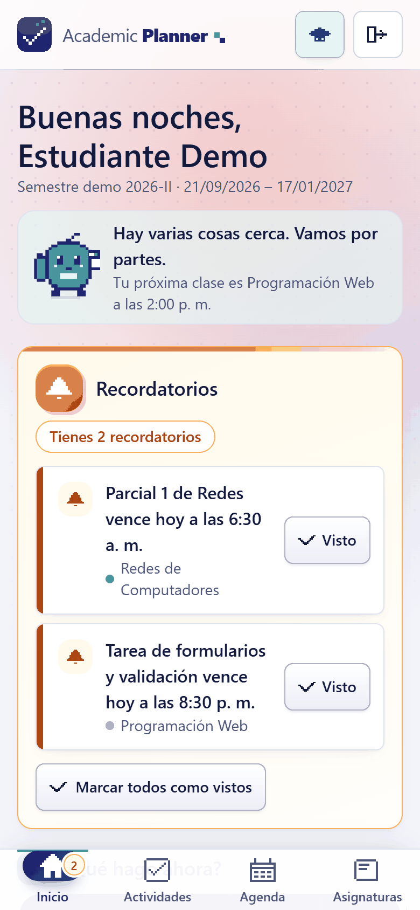
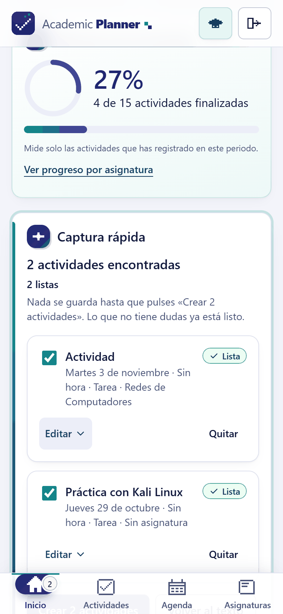
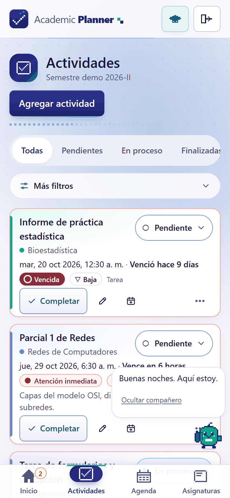
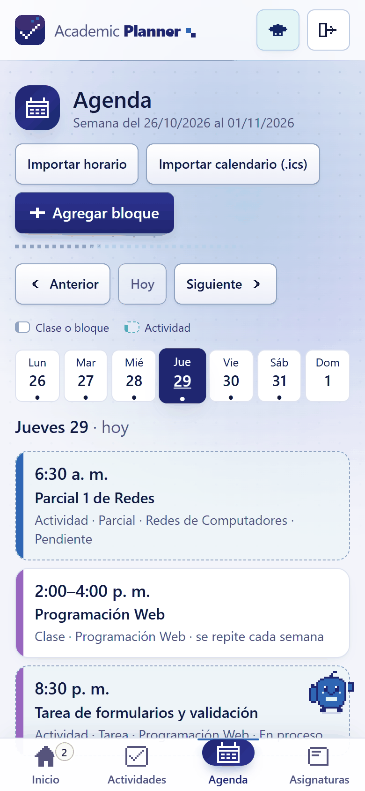
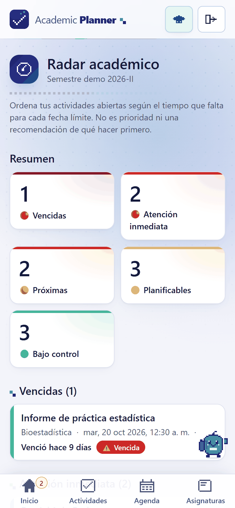
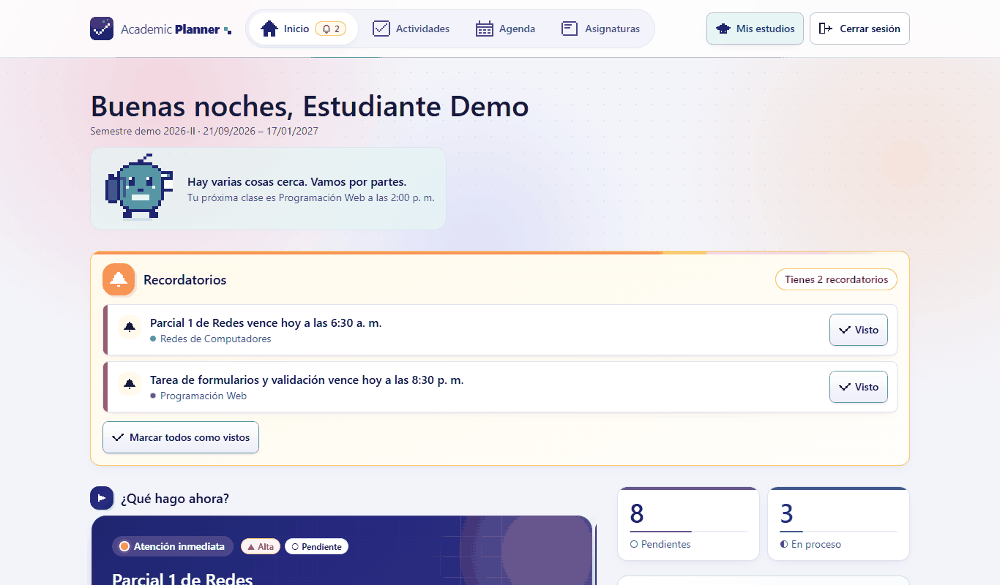
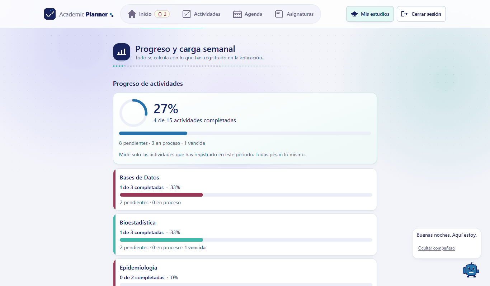
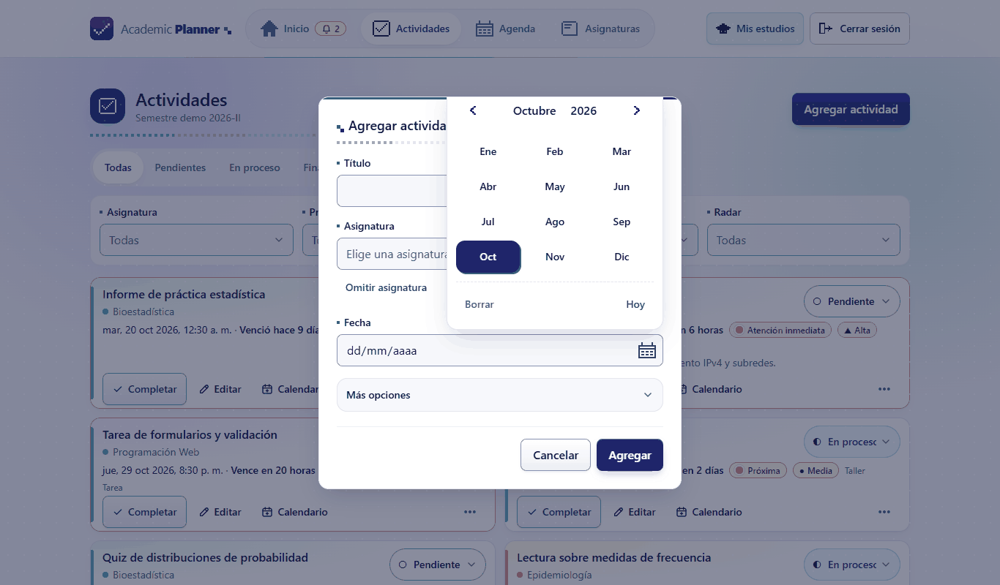

# Esqueleto de la memoria del trabajo de grado

Guía para escribir la memoria a partir de lo que ya existe en el repositorio. **No es la memoria:** es el índice con, para cada capítulo, qué va, de dónde sale el material y qué cifras se pueden citar. **Lo único que queda por completar son los datos de la universidad** (portada, director, formato); el repositorio es público y esos datos se mantienen fuera de él (ver «Privacidad»).

> **Antes de empezar:** pide a tu universidad la **guía de formato y estructura** del trabajo de grado (a veces exige capítulos, normas de citación y extensión). Si contradice este orden, manda la guía de la universidad.

## Reglas de honestidad para toda la memoria

El proyecto tiene una regla propia: _el código manda; luego las pruebas; luego los documentos_. Para la memoria:

1. **Cita solo lo que se puede comprobar.** Cada cifra de este documento viene con cómo verificarla (sección 14). Vuelve a medirla el día que entregues.
2. **No afirmes impacto académico.** El software no mide rendimiento, estrés ni notas. Puedes decir que _busca facilitar_ la organización, no que _mejora_ nada.
3. **Di claramente que no hubo prueba con usuarios.** Hubo una [evaluación funcional por un experto](expert-evaluation.md), que es otra cosa. Si tu universidad no la exige, basta con declararlo como limitación y como trabajo futuro ([user-validation.md](user-validation.md) deja el protocolo listo).
4. **Declara el uso de asistencia de IA en el desarrollo** si tu universidad lo pide. El producto no usa IA ([D4](decisions.md)); el desarrollo sí se hizo con un asistente. Consulta la política de tu institución.

## 1. Preliminares

- Portada, hoja de aprobación, dedicatoria y agradecimientos: se completan en el documento final de la memoria, **no en este repositorio público** (llevan datos personales e institucionales).
- **Resumen (150–250 palabras) y palabras clave.** Estructura: problema → qué se construyó → cómo (tecnologías, método) → resultado → limitación principal. Y su **Abstract** en inglés.
- Tabla de contenido, lista de figuras y de tablas (se generan al final).

## 2. Introducción

Contexto (estudiantes que reciben horarios, mensajes y fechas por muchos canales), el problema en una frase, la solución en una frase, y el mapa del documento. Material: [system-overview.md](system-overview.md) (sección «El problema que aborda»).

## 3. Planteamiento del problema

- **Descripción.** Un estudiante reparte sus compromisos entre mensajes de profesores, un horario en imagen o PDF, notas sueltas y fechas de parciales; organizarlo exige pasos manuales repetidos.
- **Pregunta de investigación / de desarrollo:** ¿cómo reducir el trabajo de organizar la vida académica sin añadir otra tarea al estudiante? (reformúlala con tu director).
- **Principio rector del proyecto:** _«la aplicación debe organizar lo que el estudiante ya recibe»_ y _«organizarse no debe convertirse en otra tarea»_ (CLAUDE.md del repositorio; [roadmap-post-rc.md](roadmap-post-rc.md)).
- **Fuentes para justificar el problema** (verificadas en línea el 2026-10-29; confirma los datos en el original antes de citar):
  - Steel, P. (2007). _The nature of procrastination: A meta-analytic and theoretical review of quintessential self-regulatory failure._ Psychological Bulletin, 133(1), 65–94. DOI 10.1037/0033-2909.133.1.65. Define la procrastinación como retrasar voluntariamente una acción pretendida pese a esperar un resultado peor, y la liga a la autorregulación.
  - Britton, B. K. y Tesser, A. (1991). _Effects of time-management practices on college grades._ Journal of Educational Psychology, 83(3), 405–410. Relaciona las prácticas de gestión del tiempo, en especial la planificación a corto plazo, con las notas; las cifras exactas (por ejemplo, el porcentaje de varianza) **verifícalas en el artículo** antes de citarlas.
  - Suárez Perdomo, A. y Ruiz Alfonso, Z. (2024). Revisión sistemática (PRISMA) de intervenciones sobre gestión del tiempo y procrastinación en estudiantes universitarios, _Electronic Journal of Research in Educational Psychology_. Repositorio: <https://accedacris.ulpgc.es/handle/10553/133263>. Confirma autores, título exacto y volumen en esa página.

## 4. Justificación

Por qué importa (utilidad práctica, viabilidad técnica con herramientas web abiertas, funcionamiento en el teléfono sin instalar desde una tienda). Aporte: una PWA que **propone y el estudiante confirma**, procesa todo **localmente** (OCR incluido) y no depende de servicios de IA externos.

## 5. Objetivos

Redáctalos con verbos medibles. Propuesta basada en lo construido:

- **General:** diseñar, implementar y evaluar técnicamente una aplicación web progresiva que ayude a estudiantes universitarios a organizar asignaturas, actividades y agenda a partir de la información que ya reciben.
- **Específicos (ejemplo):**
  1. Levantar los requisitos funcionales y de calidad del sistema ([requirements.md](requirements.md)).
  2. Diseñar la arquitectura, el modelo de datos y las reglas de dominio ([architecture.md](architecture.md), [data-model.md](data-model.md), [domain-rules.md](domain-rules.md)).
  3. Implementar el sistema con captura asistida determinista: texto, `.ics` y horario en imagen o PDF ([quick-capture.md](quick-capture.md), [ics-import.md](ics-import.md), [schedule-import.md](schedule-import.md)).
  4. Implementar el funcionamiento como PWA instalable ([pwa.md](pwa.md)).
  5. Verificar el sistema con pruebas automatizadas, de seguridad y de navegador ([testing.md](testing.md), [security.md](security.md), [system-validation.md](system-validation.md)).
  6. Documentar limitaciones y trabajo futuro ([limitations.md](limitations.md)).

> Cada objetivo específico debe tener, en las conclusiones, una frase que diga si se cumplió y con qué evidencia. Si un objetivo no se puede demostrar, cámbialo ahora, no el día de la sustentación.

## 6. Alcance y limitaciones

- **Alcance:** cuenta personal por estudiante, periodos y estudios, asignaturas, actividades, agenda con recurrencia semanal, recordatorios internos, Radar, «¿Qué hago ahora?», progreso, notas por cortes, captura rápida, bandeja académica, importación de horario (imagen/PDF/`.ics`), compartir hacia la app, PWA.
- **Fuera de alcance (declarado en el proyecto):** verificación de correo, recuperación de contraseña, MFA, OAuth, roles, notificaciones push, IA, sincronización offline completa, integración con calendarios externos (salvo exportar e importar `.ics`).
- **Limitaciones:** [limitations.md](limitations.md). Las que debes escribir tal cual: sin alojamiento permanente; sin prueba con usuarios; QA en dispositivos declarada por el mantenedor sin evidencia formal; el OCR falla con tablas de bordes negros gruesos; sin licencia definida.

## 7. Marco referencial

Escribe tú la teoría; esto es el mapa de lo que el proyecto usa y debe sustentarse:

| Tema                                               | Qué explicar                                                                                  | Dónde se ve en el proyecto                           |
| -------------------------------------------------- | --------------------------------------------------------------------------------------------- | ---------------------------------------------------- |
| Aplicaciones web progresivas                       | Manifest, service worker, instalación, modo sin conexión, Share Target                        | [pwa.md](pwa.md), [share-target.md](share-target.md) |
| Arquitectura por capas y monorepo                  | Ruta → controlador → servicio → repositorio; reglas puras compartidas                         | [architecture.md](architecture.md), D10, D14         |
| Bases de datos relacionales                        | Integridad, transacciones, restricciones (`CHECK`, índices parciales), migraciones            | [data-model.md](data-model.md), D1                   |
| Seguridad web                                      | Sesiones en BD, cookies `HttpOnly`/`__Host-`, verificación de origen, aislamiento por usuario | [security.md](security.md), D2, D12                  |
| Manejo de fechas y zonas horarias                  | Instantes UTC + zona del usuario, «vencida» derivada                                          | D3, D7, [domain-rules.md](domain-rules.md)           |
| Procesamiento de lenguaje natural basado en reglas | Interpretación determinista del español, sin modelos generativos                              | D4, [capture-proposals.md](capture-proposals.md)     |
| OCR                                                | Reconocimiento local con Tesseract (WebAssembly), layout de tablas por geometría              | D8, [schedule-import.md](schedule-import.md)         |
| Usabilidad y accesibilidad                         | Heurísticas, tamaño de controles, contraste, lector de pantalla                               | [ux-accessibility.md](ux-accessibility.md)           |
| Pruebas de software                                | Pruebas unitarias, de integración, end-to-end, de seguridad, _mutation checks_                | [testing.md](testing.md)                             |

**Estado del arte.** Comparación basada en la **documentación pública** de cada producto (consultada el 2026-10-29), no en una evaluación propia de cada uno; por eso las celdas dicen lo que el producto _documenta_, no lo que no puede hacer.

| Producto                            | Qué documenta                                                                                                                                                                                                       | Fuente                                                     |
| ----------------------------------- | ------------------------------------------------------------------------------------------------------------------------------------------------------------------------------------------------------------------- | ---------------------------------------------------------- |
| My Study Life                       | Planificador de clases, tareas y exámenes con recordatorios; sincronización entre dispositivos y uso sin conexión                                                                                                   | <https://mystudylife.com>                                  |
| Todoist                             | Reconocimiento de fechas en lenguaje natural al escribir el nombre de la tarea («Quick Add»); es de propósito general                                                                                               | <https://todoist.com/help/articles/205325931>              |
| Google Calendar                     | Importación manual de archivos `.ics` desde Configuración → Importar y exportar                                                                                                                                     | <https://support.google.com/calendar/answer/37118>         |
| **Academic Planner (este trabajo)** | Interpreta mensajes del profesor en español sin servicios externos y **propone antes de guardar**; importa horario desde imagen/PDF con OCR local o desde `.ics`; PWA instalable con Share Target; notas por cortes | [system-overview.md](system-overview.md), [pwa.md](pwa.md) |

Lo que este trabajo busca aportar frente a esas herramientas **no es una función aislada**, sino la combinación: (1) entrada en lenguaje natural del español académico, (2) procesamiento local sin IA externa, (3) confirmación obligatoria antes de guardar y (4) enfoque universitario con periodos, cortes y notas. Antes de afirmarlo como diferencia, comprueba tú mismo en cada producto que no ofrezca ya alguna de esas piezas: esta comparación no es exhaustiva y los productos cambian.

## 8. Metodología

- **Metodología aplicada: desarrollo incremental por fases con puertas de aprobación (_stage-gate_).** Es lo que se hizo en todo el proyecto; los nombres equivalentes en la literatura son «modelo incremental» con «puertas de calidad». **No fue Scrum** (no hubo sprints, roles ni reuniones diarias): no lo describas así.
- **El ciclo de cada fase:** (1) el alcance lo entrega el desarrollador explícitamente y solo se implementa eso; (2) implementación; (3) verificación; (4) informe de cierre que termina exactamente en `FASE N APROBADA` o `FASE N BLOQUEADA`; (5) un PR por fase, que no se fusiona sin orden. Nunca se avanza a la fase siguiente por iniciativa propia.
- **Puerta de aprobación (criterio de «terminado»):** lint, formato, tipos, pruebas, compilación, migraciones, verificación en navegador y ningún defecto bloqueante.
- **Tres etapas del proyecto:**
  1. **Roadmap original, fases 0 a 20** ([phase-history.md](phase-history.md)): análisis y decisiones; base técnica; autenticación; periodos y asignaturas; actividades y panel de inicio; agenda; recordatorios; Radar; «¿Qué hago ahora?»; progreso y carga; captura rápida; bandeja; PWA; importación de horario; accesibilidad; seguridad; validación integral; datos de demostración; documentación; Release Candidate.
  2. **Ciclo post-RC por etapas y objetivos** ([roadmap-post-rc.md](roadmap-post-rc.md)): pull requests pequeños, cada uno con aprobación explícita; incluye la importación `.ics`, el Share Target, las notas por cortes, el perfil educativo y los estudios.
  3. **Release gate** (RG-0 a RG-4): auditoría de preparación, validación de despliegue con HTTPS temporal, seguridad y respaldo, y publicación de `v1.0.0-rc.1` a `rc.3` y `v1.0.0` como beta cerrada ([release-readiness-audit.md](release-readiness-audit.md)).
- **Reglas de calidad propias:** la fuente de verdad es **código → pruebas → documentos** (si un documento contradice al código, se corrige el documento); los hallazgos graves se corrigen y los menores se documentan; las reglas críticas se verifican con _mutation checks_ (se rompe a propósito la regla, se confirma que la prueba falla y se revierte); una prueba intermitente se investiga con su traza, no se repite hasta que pase; las versiones publicadas son inmutables.
- **Línea de tiempo verificable:** el primer commit es del 2026-10-04 y `v1.0.0` se publicó el 2026-10-28 (`git log` y las notas de versión). Las cifras de commits y PR se vuelven a medir el día de la entrega (sección 14).
- **Asistencia en el desarrollo:** el proyecto se desarrolló con un asistente de IA (Claude Code) bajo estas reglas; el desarrollador definía el alcance, aprobaba cada etapa y decidía qué se fusionaba. Descríbelo así en la memoria y ajusta la redacción a la política de tu universidad.
- **Gestión de decisiones:** 36 decisiones numeradas con contexto y consecuencias ([decisions.md](decisions.md)); es un buen anexo.
- **Control de versiones y entrega:** Git con ramas por objetivo, PR sin fusionar sin orden, versiones `v1.0.0-rc.1` → `rc.2` → `rc.3` → `v1.0.0` ([release-manifest.md](release-manifest.md)).
- **Herramientas y versiones:** Node, PostgreSQL 17, Express 5, Prisma 7, React 19, Vite, Tailwind 4, TanStack Query, Zod, Vitest, Playwright, Tesseract.js ([development.md](development.md)).

## 9. Análisis (requisitos)

- Requisitos funcionales originales RF01–RF09 con su estado y evidencia: [requirements.md](requirements.md). **Atención:** ese documento advierte que el texto original de RF01–RF09 no está en el repositorio; usa los de tu anteproyecto si los tienes, y alinéalos.
- Requisitos no funcionales: seguridad, privacidad (OCR local), accesibilidad (controles ≥ 44 px, legible a 360 px), rendimiento ([system-validation.md](system-validation.md)).
- **Historias de usuario** (con su evidencia automatizada en `e2e/`):

| #   | Como estudiante quiero…                                                     | Evidencia                                                                  |
| --- | --------------------------------------------------------------------------- | -------------------------------------------------------------------------- |
| H1  | crear mi cuenta y dejar listo mi semestre sin llenar formularios largos     | `onboarding.spec.ts`, `onboarding-study.spec.ts`                           |
| H2  | pegar un mensaje del profesor y que la app proponga mis actividades         | `capture.spec.ts`, `capture-recurrence.spec.ts`                            |
| H3  | revisar y corregir lo propuesto antes de que se guarde                      | `capture.spec.ts`, `forms-dialogs.spec.ts`                                 |
| H4  | importar mi horario desde una imagen, un PDF o un archivo `.ics`            | `schedule-import.spec.ts`, `ics-import.spec.ts`                            |
| H5  | saber a qué darle atención primero y por qué                                | `attention.spec.ts`, `radar.spec.ts`                                       |
| H6  | ver mi semana (clases y entregas) y llevar una actividad a mi calendario    | `calendar.spec.ts`, `agenda-activities.spec.ts`, `calendar-export.spec.ts` |
| H7  | registrar mis notas por cortes y saber cuánto necesito para aprobar         | `subject-grades.spec.ts`, `capture-grades.spec.ts`                         |
| H8  | usarla desde el teléfono, instalada y compartiéndole texto desde otras apps | `pwa.spec.ts`, `share-target.spec.ts`                                      |

## 10. Diseño

- **Arquitectura general** (diagrama C4 nivel 1–2): navegador (PWA) ↔ API Express ↔ PostgreSQL; paquete `core` compartido. Material: [architecture.md](architecture.md), [system-overview.md](system-overview.md).
- **Modelo de datos** (diagrama entidad-relación): 12 modelos Prisma y 15 migraciones. [data-model.md](data-model.md), `apps/api/prisma/schema.prisma`.
- **Reglas de dominio:** [domain-rules.md](domain-rules.md), [attention-engine.md](attention-engine.md), [radar.md](radar.md), [progress-and-workload.md](progress-and-workload.md).
- **Flujo central «proponer → confirmar» (D5, D16, D24):** diagrama de secuencia CAPTURAR → INTERPRETAR → PROPONER → CONFIRMAR. Es la idea de diseño más defendible del proyecto: nada se guarda sin ver la propuesta.
- **Decisiones de diseño a defender** (cada una con su porqué en [decisions.md](decisions.md)):

| Decisión                             | Argumento en una línea                                                                          |
| ------------------------------------ | ----------------------------------------------------------------------------------------------- |
| D4 Sin IA generativa                 | Resultados reproducibles, sin enviar datos a terceros, sin costo ni dependencia                 |
| D5 Proponer antes de guardar         | El estudiante conserva el control y se evitan datos inventados                                  |
| D8 OCR local                         | Privacidad: la imagen del horario no sale del servidor propio                                   |
| D2 Sesiones en BD, no JWT            | Revocación inmediata y menos superficie de ataque                                               |
| D3 Zona horaria del usuario          | Fechas correctas sin cálculos de zona en la interfaz                                            |
| D7 No persistir datos derivados      | «Vencida», Radar y progreso se calculan al leer; no hay estados que desincronizar               |
| D36 Notas por materia → corte → nota | Cada materia define su propia distribución; aritmética exacta (BigInt), sin errores de redondeo |

- **Interfaz y experiencia:** [ux-accessibility.md](ux-accessibility.md), [pixel-companion.md](pixel-companion.md). Capturas con datos de demostración (cuenta «Estudiante Demo», sin datos reales), tomadas el 2026-10-29 con la versión compilada:

| Figura | Qué muestra                                                  | Imagen                                                  |
| ------ | ------------------------------------------------------------ | ------------------------------------------------------- |
| 1      | Inicio en el teléfono                                        |              |
| 2      | Captura rápida: dos propuestas que se revisan antes de crear |                 |
| 3      | Actividades en el teléfono                                   |                |
| 4      | Agenda de la semana                                          |                          |
| 5      | Radar académico                                              |                            |
| 6      | Inicio en escritorio                                         |       |
| 7      | Progreso en escritorio                                       |                 |
| 8      | Selector de fecha con la cuadrícula de meses                 |  |

Para repetirlas: `npm run db:seed:demo -- --allow-demo` y [demo.md](demo.md).

## 11. Implementación

Resumen por módulo, sin pegar código: qué hace, qué decisión técnica lo define y un ejemplo.

| Módulo                           | Qué destacar                                                                                          | Documento                                                                          |
| -------------------------------- | ----------------------------------------------------------------------------------------------------- | ---------------------------------------------------------------------------------- |
| Autenticación y sesiones         | Argon2id, cookie `HttpOnly`, límites de frecuencia                                                    | [auth.md](auth.md)                                                                 |
| Actividades y recordatorios      | Recordatorios automáticos por tipo; manuales nunca se sobrescriben                                    | [activities.md](activities.md), [reminders.md](reminders.md)                       |
| Captura rápida                   | Intérprete determinista del español (fechas relativas, listas, correcciones, días anunciados primero) | [capture-proposals.md](capture-proposals.md), [quick-capture.md](quick-capture.md) |
| Importación de horario           | OCR local + detección de tabla por geometría; confirmación en lote todo o nada                        | [schedule-import.md](schedule-import.md)                                           |
| Importación y exportación `.ics` | Eventos únicos y clases semanales; añadir al calendario                                               | [ics-import.md](ics-import.md), [calendar-export.md](calendar-export.md)           |
| Notas                            | Escala, cortes, ¿cuánto necesito? exacto                                                              | [academic.md](academic.md), [grades-validation.md](grades-validation.md)           |
| PWA                              | Solo precachea el shell; la API nunca se guarda en caché; la actualización nunca recarga sola         | [pwa.md](pwa.md)                                                                   |
| Seguridad                        | Matriz de rutas y de propiedad de recursos probada automáticamente                                    | [security.md](security.md)                                                         |

## 12. Pruebas y resultados

Qué se midió, con qué, y con qué resultado. Esta es la sección donde el proyecto es más fuerte.

- **Pruebas automatizadas (Vitest):** core 1419, API 1578, web 729 (medidas el 2026-10-28). Más 273 de seguridad (subconjunto de las de la API).
- **Pruebas de navegador (Playwright):** 918 pruebas registradas (47 archivos, dos tamaños de pantalla: 1366 px y 360 px). La última corrida completa **registrada en los documentos** es la de la fase RG-3 ([rg3-results.md](rg3-results.md)); la de hoy no se completó (ver nota).
- **Pruebas de seguridad:** [security.md](security.md) y `npm run test:security`; `npm audit --omit=dev` = 0 vulnerabilidades en producción.
- **Validación del sistema:** escenario maestro, rendimiento y migraciones desde base vacía ([system-validation.md](system-validation.md), [release-validation.md](release-validation.md)).
- **Validación de las notas con casos reales documentados** (no con estudiantes): [grades-validation.md](grades-validation.md).
- **Evaluación funcional por un experto:** [expert-evaluation.md](expert-evaluation.md) (9 funciones recorridas; 1 hallazgo medio de desarrollo documentado sin corregir; 3 menores documentados; 1 límite del OCR documentado).
- **PWA:** 60 pruebas de PWA y de compartir hacia la app pasan en Edge; el aviso de actualización se comprobó con una versión vieja y una nueva.
- **Despliegue:** HTTPS real solo temporal, con un túnel de Cloudflare (RG-2b): 36 pruebas de humo, 0 fallos ([release-validation.md](release-validation.md)).
- **QA en teléfonos:** declarada por el mantenedor sin evidencia formal (RG-3, [rg3-results.md](rg3-results.md)). Escríbelo exactamente así.

> **Nota sobre las cifras:** una corrida completa de Playwright el 2026-10-28 no sirvió por procesos huérfanos de desarrollo, y un subconjunto con fechas dio 252 pasadas y 3 timeouts que pasan al correrlas solas. Si citas Playwright, **corre la suite completa justo antes de entregar** (`PW_CHANNEL=msedge npm run test:browser`, con los puertos 3000 y 5173 libres) y cita esa cifra.

**Tabla sugerida de resultados:** una fila por objetivo específico, con la evidencia que lo demuestra y su estado (cumplido / parcial / no cumplido).

## 13. Conclusiones, limitaciones y trabajo futuro

- **Conclusiones:** una por objetivo específico, con evidencia. Evita adjetivos («excelente», «innovador») sin respaldo.
- **Limitaciones** (sección 6, con más detalle) y **amenazas a la validez:** sin usuarios reales, un solo desarrollador evaluando su propio trabajo, QA en teléfonos sin evidencia formal, OCR probado con pocos horarios.
- **Trabajo futuro** (todo ya está en [roadmap-post-rc.md](roadmap-post-rc.md)): prueba con usuarios ([user-validation.md](user-validation.md)), alojamiento permanente, verificación de correo y recuperación de contraseña, mejora del OCR con bordes negros, feed de calendario, IA asistiva opcional (D21).

## 14. Cómo volver a medir cada cifra

| Cifra                         | Comando o lugar                                                                        |
| ----------------------------- | -------------------------------------------------------------------------------------- |
| Pruebas Vitest                | `npm test`                                                                             |
| Pruebas de seguridad          | `npm run test:security && npm run test:security:browser`                               |
| Pruebas de navegador          | `PW_CHANNEL=msedge npm run test:browser` (puertos 3000 y 5173 libres)                  |
| Vulnerabilidades              | `npm audit --omit=dev`                                                                 |
| Migraciones desde base vacía  | `npm run validate:fresh-db`                                                            |
| Número de commits y PR        | `git log --oneline \| wc -l` y la lista de PR en GitHub                                |
| Modelos de la base de datos   | `apps/api/prisma/schema.prisma` (cuenta los `model`)                                   |
| Estado y versiones publicadas | [project-state.md](project-state.md), [release-notes-1.0.0.md](release-notes-1.0.0.md) |

## 15. Referencias

Usa la norma que pida tu universidad (APA, IEEE…). Material verificable para empezar (confirma edición y datos antes de citar):

- Brooke, J. (1996). _SUS: A «quick and dirty» usability scale_ (si haces la prueba con usuarios).
- W3C. _Web Content Accessibility Guidelines (WCAG) 2.2._
- W3C. _Web Application Manifest_ y _Service Workers_ (especificaciones).
- OWASP. _Application Security Verification Standard (ASVS)._
- Documentación oficial de PostgreSQL, Express, Prisma, React, Vite, Playwright, Tesseract.
- Steel (2007), Britton y Tesser (1991) y Suárez Perdomo y Ruiz Alfonso (2024): datos en la sección 3.
- Documentación pública de los productos comparados: <https://mystudylife.com>, <https://todoist.com/help/articles/205325931>, <https://support.google.com/calendar/answer/37118>.
- Si tu universidad lo exige, agrega artículos en español o de revistas locales sobre el tema: búscalos tú y cita solo lo que hayas leído.

## 16. Anexos sugeridos

A. Diagrama de arquitectura y modelo entidad-relación. B. Tabla de decisiones ([decisions.md](decisions.md)). C. Matriz de requisitos y evidencia ([requirements.md](requirements.md)). D. Evaluación funcional ([expert-evaluation.md](expert-evaluation.md)). E. Capturas de pantalla. F. Resultados de pruebas. G. Manual de instalación y uso ([development.md](development.md), [demo.md](demo.md)). H. Limitaciones ([limitations.md](limitations.md)).

## 17. Sustentación: preguntas probables

| Pregunta                                             | Dónde está la respuesta                                                                                          |
| ---------------------------------------------------- | ---------------------------------------------------------------------------------------------------------------- |
| ¿Por qué no usaste IA para interpretar los mensajes? | D4, D21: reproducible, privado y sin costo; la IA asistiva queda como trabajo futuro                             |
| ¿Qué pasa si el intérprete se equivoca?              | D5: nada se guarda sin que el estudiante revise y confirme; los casos dudosos se marcan                          |
| ¿Cómo garantizas que un usuario no ve datos de otro? | D12, matriz de propiedad de recursos probada automáticamente ([security.md](security.md))                        |
| ¿Funciona sin internet?                              | Parcialmente: abre el shell, avisa y no muestra datos ([pwa.md](pwa.md), D6)                                     |
| ¿Se probó con estudiantes?                           | No. Se hizo una evaluación funcional por un experto y queda el protocolo para hacerlo                            |
| ¿Está en producción?                                 | No hay alojamiento permanente; se validó con HTTPS temporal ([release-validation.md](release-validation.md))     |
| ¿Qué falla hoy?                                      | [limitations.md](limitations.md); entre otros, el OCR con bordes negros gruesos                                  |
| ¿Cuánto trabajo tuyo hay y cuánto de la herramienta? | Prepara una respuesta honesta sobre el uso del asistente de desarrollo (sección «Reglas de honestidad», punto 4) |

## 18. Privacidad: el repositorio es público

Esta memoria usa un repositorio público de GitHub como evidencia. Reglas para no filtrar datos personales:

- **Nada personal en el repositorio ni en los documentos:** ni nombre completo, ni correo personal, ni teléfono, ni documento de identidad, ni datos de la universidad, el director o los jurados. Esos datos viven solo en el archivo final de la memoria (Word o PDF), que **no** se sube.
- **Capturas solo con la cuenta de demostración** («Estudiante Demo») o con datos inventados; nunca con tu cuenta real, tus materias reales, tu horario real ni la barra de direcciones con rutas locales.
- **Archivos de configuración:** `.env` no está versionado (solo `.env.example`, con valores de ejemplo). Antes de publicar, revisa con `git grep -n -i "tu-correo\|tu-apellido"` que no haya nada tuyo.
- **Metadatos de los commits (revísalo):** cada commit lleva el nombre y el correo configurados en Git. Si usaste tu correo personal, quedan visibles en el historial público. GitHub ofrece un correo anónimo `ID+usuario@users.noreply.github.com` (Settings → Emails → «Keep my email addresses private» y «Block command line pushes that expose my email») para que los commits **nuevos** no lo expongan; los antiguos solo se pueden limpiar reescribiendo el historial, lo que rompe PR, etiquetas y versiones publicadas y debe hacerse sabiendo lo que implica.
- **Datos de usuarios de prueba:** si algún día pruebas con estudiantes, no se guardan datos reales en el repositorio ni en las capturas (ver [user-validation.md](user-validation.md)).

## 19. Lista para entregar

- [ ] Guía de formato de la universidad aplicada.
- [ ] Objetivos redactados y cada uno con su evidencia en las conclusiones.
- [ ] Cifras vueltas a medir el mismo día (sección 14).
- [ ] Suite completa de navegador corrida y registrada.
- [ ] Capturas de pantalla actuales.
- [ ] Referencias leídas y con formato.
- [ ] Limitaciones y falta de prueba con usuarios escritas sin rodeos.
- [ ] Demo probada en el equipo que se usará en la sustentación, con datos demo y sin depender de internet si es posible.
- [ ] Licencia decidida.
